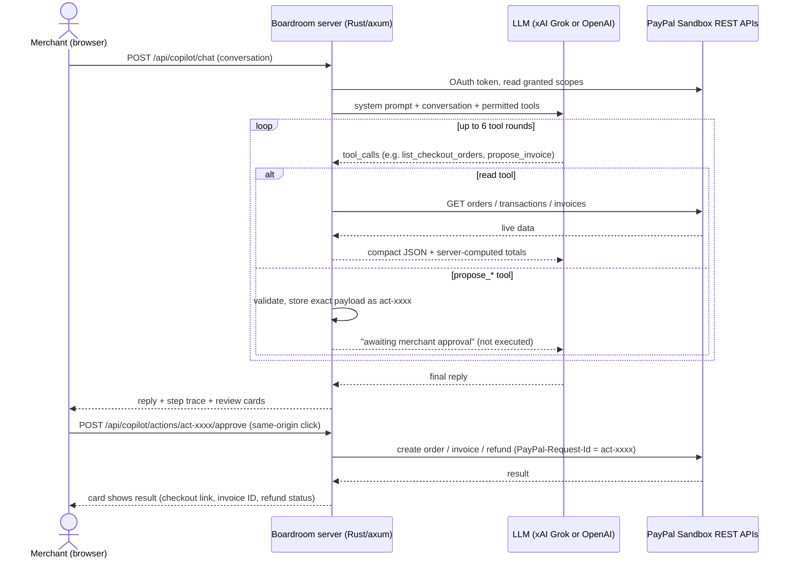

# Boardroom Copilot: an AI operations agent for PayPal merchants

**Boardroom Copilot** lets a small-business owner run their PayPal back office in plain English:

> *"Invoice jordan@example.com for 3 hours of consulting at $60/hour plus a $25 setup fee, due in 15 days."*
> *"Has my latest checkout been paid? If so, refund $5 as a goodwill credit."*
> *"Summarize my sales for the last 30 days. Who are my top customers?"*

An AI agent reads the merchant's **live PayPal Sandbox data** through PayPal REST APIs and drafts **real PayPal actions**: checkout links, invoices, and refunds. Every action appears as a review card with exact amounts and line items. **Nothing reaches PayPal until the merchant clicks Approve.**

It sits inside *The Boardroom*, a concept business workspace that also includes a PayPal card-payment lab, a Sandbox checkout, and invoice tools.

> **Independent hackathon prototype.** Not affiliated with or endorsed by PayPal, Inc. It runs **only** against PayPal Sandbox (test money) and refuses to start in production mode. Every figure in the workspace comes from real Sandbox activity created through the app; nothing is sample data.

---

## How this meets the hackathon requirements

| Requirement | How Boardroom Copilot meets it | Where to look |
|---|---|---|
| **Meaningful PayPal integration** | Orders v2 (create, read, capture), Payments v2 (refunds), Payouts v1 (send money), Invoicing v2 (draft, list, send, remind, cancel), Transaction Search and Balances (reporting), OAuth 2.0 client credentials with **scope-based feature detection**, `PayPal-Request-Id` idempotency, JavaScript SDK CardFields with 3-D Secure, Sandbox negative testing, and PayPal MCP server configuration | [src/main.rs](src/main.rs), [src/copilot.rs](src/copilot.rs), [public/checkout-lab.js](public/checkout-lab.js) |
| **Meaningful use of AI** | A tool-calling agent turns natural language into grounded PayPal reads and validated PayPal actions, with a human approval step for every money-moving action. The Boardroom brief has four AI advisors read the merchant's real figures and hand a first step back to the agent | [src/copilot.rs](src/copilot.rs), [src/boardroom.rs](src/boardroom.rs), [src/llm.rs](src/llm.rs), [public/copilot.js](public/copilot.js) |
| **Working prototype** | `cargo run` serves the full app. Verified against live PayPal Sandbox on 7 Nov 2026 (real orders created and read back) and 8 Nov 2026 (payment request, Payouts batch, activity record surviving a restart). 52 Rust and 31 browser-logic tests, including full agent runs and workspace flows against a mock LLM and a mock PayPal | [Run it](#run-it-locally), [Tests](#tests) |
| **Documentation** | This README: demo script, architecture, tool catalog, safety model, setup, limitations | You are here |

---

## 3-minute demo script

Start the app ([setup below](#run-it-locally)), open `http://localhost:3000`, and choose **Boardroom AI → Copilot**. The status chips show which AI model is connected and which PayPal features the Sandbox app is permitted to use.

1. **Payment link (Orders v2).** Click **$45 payment link**.
   - The Copilot calls `propose_payment_link`. A review card shows the amount and description, marked *"Nothing has been sent to PayPal yet."*
   - Click **Create checkout link**. The server creates a real Sandbox order and shows **Open PayPal Sandbox checkout ↗**.
   - Pay with a [Sandbox personal (buyer) account](https://developer.paypal.com/dashboard/accounts). PayPal returns the buyer to the app, which captures the payment.
2. **Live status and refund (Orders v2 + Payments v2).** Click **Check payment & refund**.
   - The Copilot reads the order's live status from PayPal (`list_checkout_orders`), sees the completed capture, and drafts a $5.00 refund card showing the captured amount.
   - Approve it, and PayPal returns the refund ID and status.
3. **Invoice from a sentence (Invoicing v2).** Click **Draft an invoice**.
   - The Copilot builds an itemized invoice: 3 hours × $60.00/hr, a $25.00 setup fee, Net 15, $205.00 total.
   - Approve it to create a PayPal draft, then click **Send invoice**.
4. **Grounded analysis (Transaction Search + Invoicing).** Click **30-day sales summary** or **Unpaid invoices**.
   - The server computes gross, refunds, fees, net, top payers, and outstanding or overdue invoices from PayPal data.
   - The model explains those numbers; it is told not to do its own arithmetic.

Steps 3 and 4 require the **Invoicing** and **Transaction search** features on the Sandbox app ([setup step 2](#run-it-locally)). Until they are enabled, the Copilot hides those tools and tells the merchant how to turn them on.

---

## How it works



### The agent's tools

| Tool | PayPal API | Kind | Offered when |
|---|---|---|---|
| `list_checkout_orders` | `GET /v2/checkout/orders/{id}` | Read | Always |
| `search_transactions` | `GET /v1/reporting/transactions` | Read | Token has Transaction Search scope |
| `list_invoices` | `GET /v2/invoicing/invoices` | Read | Token has Invoicing scope |
| `propose_payment_link` | `POST /v2/checkout/orders` | Proposal (needs approval) | Always |
| `propose_refund` | `POST /v2/payments/captures/{id}/refund` | Proposal (needs approval) | Always |
| `propose_invoice` | `POST /v2/invoicing/invoices` (then `/send`) | Proposal (needs approval) | Token has Invoicing scope |

The AI client speaks the OpenAI-compatible Chat Completions format with function calling, so it works with **xAI Grok** (default `grok-4.7`), **OpenAI**, or any compatible endpoint set with `AI_BASE_URL`.

### Safety and trust design

Letting an AI near money needs guardrails. These are enforced on the **server**, not by the prompt:

- **The model cannot execute anything.** `propose_*` tools only validate and store a payload. The approve endpoint is a separate same-origin `POST`, triggered by the merchant's click, which the model cannot call.
- **What you see is what runs.** The review card is rendered from the stored payload, and approval executes exactly that payload. Each proposal runs at most once; repeating or racing approvals gets `409 Conflict`.
- **Idempotent writes.** The proposal ID is sent as `PayPal-Request-Id`, so a retried request is not duplicated.
- **Strict validation.** Proposals are limited to USD, amounts up to $9,999.99, and integer-cent arithmetic (no floating point). Invoice and payout recipients must be test addresses at the reserved `example.com` domain or a subdomain of it (where PayPal puts Sandbox accounts, such as `sb-…@personal.example.com`). Refunds are allowed only on orders this app created and captured, and the remaining balance is re-checked with PayPal at approval time.
- **Least privilege by construction.** Tools are offered only when the Sandbox app's OAuth scopes allow them.
- **Grounded answers.** Totals are computed server-side from PayPal data. Text from buyers or customers is shortened and labeled as data, not instructions, to limit prompt injection.
- **Honest failures.** If the AI provider fails, the user sees the error. No scripted answer is substituted.
- **Sandbox only.** The PayPal base URL is hard-coded to Sandbox, and the server binds to `127.0.0.1`.

---

## Run it locally

**Prerequisites:** [Rust](https://rustup.rs) (stable, edition 2024), a [PayPal Developer](https://developer.paypal.com) account, and an API key from [xAI](https://console.x.ai) or [OpenAI](https://platform.openai.com).

1. **Create a Sandbox app.** In the PayPal Developer Dashboard, open **Apps & Credentials**, select **Sandbox**, then **Create App** (type *Merchant*). Copy its Client ID and Secret.
2. **Enable the PayPal features.** In the app's **Features** section, tick **Invoicing**, **Transaction search**, and **Payouts**, then save. Allow a few minutes for the change to take effect. Orders, payment links, and refunds work without this step; each page explains what is missing until then.
3. **Configure.**
   ```bash
   cp .env.example .env
   # set PAYPAL_CLIENT_ID, PAYPAL_CLIENT_SECRET, and XAI_API_KEY (or OPENAI_API_KEY)
   ```
4. **Run.**
   ```bash
   cargo run
   ```
   Open **http://localhost:3000** (it must match `APP_BASE_URL`). The console prints which AI model the Copilot is using.

| Variable | Required | Purpose |
|---|---|---|
| `PAYPAL_CLIENT_ID`, `PAYPAL_CLIENT_SECRET` | Yes | Sandbox REST app credentials |
| `XAI_API_KEY` / `XAI_MODEL` | One AI key | xAI Grok (default model `grok-4.7`); preferred if both keys are set |
| `OPENAI_API_KEY` / `OPENAI_MODEL` | One AI key | OpenAI (default model `gpt-4.1-mini`) |
| `AI_BASE_URL` | No | Any other OpenAI-compatible endpoint (https, or http on localhost) |
| `PORT`, `APP_BASE_URL` | No | Defaults `3000` and `http://localhost:3000` |
| `DATA_DIR` | No | Where the activity record (`ledger.json`) is kept. Default: `data/` in the project |
| `ENABLE_NEGATIVE_TESTING`, `NEGATIVE_TEST_TYPE` | No | Sandbox error simulation (see below) |

Without an AI key, the rest of the workspace still runs; the Copilot and the Boardroom brief show how to enable it.

---

## Tests

```bash
cargo test                    # 52 backend tests
node --test tests/*.test.js   # 31 browser-logic tests (Node.js 20+; no npm install needed)
```

Highlights:

- **End-to-end agent runs** ([src/copilot/tests.rs](src/copilot/tests.rs)) start a mock LLM and a mock PayPal on local ports. They then prove that:
  - nothing is written to PayPal before approval;
  - approval sends exactly the reviewed payload with `PayPal-Request-Id` set to the proposal ID;
  - a second approval is refused;
  - cross-origin approval is rejected;
  - tools without PayPal permission are hidden and refused;
  - over-limit refunds and refunds on unknown orders are blocked.
- **Workspace flows** ([src/workspace/tests.rs](src/workspace/tests.rs)) run against a mock PayPal and prove that:
  - a payment request is recorded from creation through capture (reading the order back when PayPal's capture reply is minimal) and refund;
  - an idempotent refund retry is counted once, and refunds above PayPal's current balance are refused;
  - payouts need the Payouts permission, an `example.com` recipient, and a fresh request ID (a repeat gets `409`);
  - invoices share the Copilot's validator, and statuses such as `PAID` sync back from PayPal;
  - dashboard figures (gross, average order, repeat customers, refunds, trends, daily series) are computed correctly from recorded captures.
- Unit tests cover the money parser, invoice totals, transaction and invoice summaries, conversation validation, and the existing checkout and 3-D Secure capture rules.
- The browser tests ([tests/](tests/)) check that:
  - Copilot proposals, payment requests, payouts, and refunds are reviewed before anything is sent;
  - only PayPal-hosted links are shown;
  - AI errors are shown without a scripted fallback, and the Boardroom's first step reaches Copilot only on click.

---

## The workspace

Every page reads from, or acts on, PayPal Sandbox. The server keeps a record of what it did with PayPal ([src/ledger.rs](src/ledger.rs), saved to `data/ledger.json` with atomic writes), because Orders v2 has no "list my orders" endpoint and Transaction Search can lag by hours.

- **Dashboard and Sales snapshot:** gross sales, average order value, repeat customers, refunds, trends against the previous period (7, 30, or 90 days), a daily sales chart, top items, and a rule-based insight, all computed from payments captured through the app.
- **Activity and Audit trail:** every order, payment request, payout, and invoice, with inline actions (refund a captured order, copy an unpaid payment link, check a payout's status). The audit trail lists each PayPal action and approval. An account-wide view loads Transaction Search when it is enabled.
- **Send & request:** *Request* creates a PayPal checkout link (Orders v2) to share. *Send* pays a Sandbox account with PayPal Payouts. Both show a review step first, and payouts carry a client request ID used as `PayPal-Request-Id` and `sender_batch_id`.
- **Wallet:** the Sandbox account's PayPal balance (Balances API, needs Transaction search), plus money in and out through the app.
- **Invoicing:** create an itemized draft, send it, remind, or cancel, and see every invoice on the Sandbox account with its live status and the customer's PayPal payment page.
- **Settings:** your name and business name. The business name is sent to PayPal as the checkout `brand_name`. Connection chips show which PayPal features the Sandbox app is allowed to use.
- **Boardroom brief:** the AI reads the dashboard figures and writes one recommendation with four advisor perspectives and an experiment. Its first step is sent to Copilot on click, where it becomes a normal review card.

- **Checkout Lab:** a fixed $10 card payment using PayPal-hosted **CardFields** (JS SDK v5), with success, decline (`CCREJECT-REFUSED` in the name field), and 3-D Secure scenarios. Before capturing a 3-D Secure order, the server checks that PayPal reports `liability_shift: POSSIBLE`. The Sandbox business account must be eligible for Advanced Credit and Debit Card Payments. PayPal recommends SDK v6 for new integrations; v5 is used here because PayPal documents its name-field decline triggers for v5.
- **Sandbox purchase:** a fixed $10 PayPal checkout. The buyer approves on PayPal, then the app captures.
- **Negative testing:** set `ENABLE_NEGATIVE_TESTING=true` and choose a `NEGATIVE_TEST_TYPE`. Write requests then carry PayPal's `PayPal-Mock-Response` header to simulate errors. Turn it off after testing.
- **PayPal MCP server:** the parent folder's `.mcp.json` configures `@paypal/mcp` against Sandbox for AI coding assistants. It reads `PAYPAL_ACCESS_TOKEN` from the host environment, not from `.env`, and enables all tools, including ones that change transactions. It is a separate developer integration, not part of the app's runtime.

---

## Limitations and notes

- **Prototype, not production.** There is no login, and the server binds to `127.0.0.1`. Orders, captures, refunds, payouts, invoices, and the profile persist in `data/ledger.json`; pending Copilot proposals are held in memory and expire on restart. Do not deploy as-is.
- **Dashboard scope.** The dashboard counts payments captured through this app. Payments made elsewhere on the Sandbox account appear in the account-wide Transaction Search view and in the Copilot's sales summaries, not in the dashboard totals.
- **Data sent to the AI provider.** The Copilot sends the conversation and the Sandbox data its tools return (amounts, statuses, payer emails and names) to the configured AI provider. A live product would need merchant consent, data minimization, and provider agreements.
- **AI can be wrong.** It may misread a request. That is why every action is a reviewable card with server-validated amounts and recipients. Read the card, not just the chat reply.
- **Invoicing payload.** The invoice request uses documented Invoicing v2 fields (`payment_term.term_type`, `items[].unit_of_measure`, `detail.note`). It has been tested against a mock, but not yet against live Sandbox, because the development Sandbox app lacked the Invoicing permission at the time of writing.
- **Transaction Search** analyzes the first 100 transactions in the period, and PayPal reporting can lag by up to three hours.
- **Tokens** are cached for up to 10 minutes, so newly enabled Sandbox features appear within that window.

## Project structure

```
src/main.rs             HTTP server, PayPal OAuth (cached, scope-aware), Orders, capture rules, invoice send, routes
src/ledger.rs           Persistent record of orders, captures, refunds, payouts, invoices, audit events
src/workspace.rs        Dashboard figures, activity, wallet, profile, payment requests, refunds, Payouts, Invoicing
src/boardroom.rs        Boardroom brief: AI advisors over the dashboard figures, strict JSON validation
src/copilot.rs          AI agent: tools, system prompt, agent loop, proposal store, approve/dismiss endpoints
src/llm.rs              OpenAI-compatible Chat Completions client (xAI Grok / OpenAI)
src/*/tests.rs          Unit tests + end-to-end tests with a mock LLM and a mock PayPal
public/dashboard.js     Dashboard, sales chart, activity (refunds, payout status), audit trail, wallet
public/workspace.js     Send & request, Invoicing, Settings
public/boardroom.js     Boardroom brief and experiment hand-off to Copilot
public/copilot.js       Copilot chat UI: step trace, review cards, approvals
public/*.js, *.html     Checkout Lab (CardFields), Sandbox purchase, navigation
tests/*.test.js       Browser-logic tests run with Node's built-in test runner
```

PayPal is a trademark of PayPal, Inc. This independent hackathon submission is not affiliated with or endorsed by PayPal, Inc.
